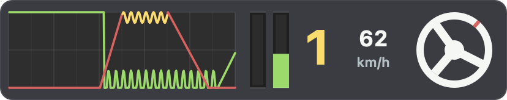

# APEX Lab — Circuit Test 1.13

面向 Apple Silicon Mac 的原生赛车驾驶原型。使用 Swift、SceneKit / Metal、Game Controller、Core Haptics 和 AVFoundation，无需 Unity 或下载第三方依赖。

这是一款独立原创原型，未使用 iRacing 的代码、车辆、赛道或其他资源，不是 iRacing 的移植版。

车辆画面（1.2 引入，本版沿用）：[Ferrari 驾驶舱](Docs/Driving-1.2/ferrari-cockpit.jpg) · [Ferrari 跟车](Docs/Driving-1.2/ferrari-chase.jpg) · [Porsche 跟车](Docs/Driving-1.2/porsche-chase.jpg)。均由原生渲染器生成，未做后期修图。Ferrari 模型：vicent091036，CC BY 4.0；Porsche 模型：Lionsharp Studios / Karol Miklas，CC BY-SA 4.0。完整署名和改动见 [车辆资源说明](Assets/Vehicles/README.md)。

1.5 检查图：[Porsche 动态仪表](Docs/Driving-1.5/car-2-cockpit.jpg) · [车外](Docs/Driving-1.5/car-2-exterior.jpg) · [立体路肩](Docs/Driving-1.5/track-kerb.jpg) · [看台](Docs/Driving-1.5/track-stand.jpg)。[图片署名](Docs/Driving-1.5/README.md)。

## 运行

下载发布包后解压，双击 `APEX Lab.app`。从源码构建后，应用位于 `dist/APEX Lab.app`；该目录不纳入 Git 版本控制。建议将应用放在可写文件夹中。

系统要求：Apple Silicon，macOS 14 或以上。源代码构建需要 Xcode 命令行工具。

```sh
./build.sh --run
```

## 1.13 授权原模 · Lamborghini Centenario

外观和内饰来自 SDC PERFORMANCE 的完整模型，保留原模型的 325,733 个三角面、材质和 7 张贴图。车辆支持六种视角、原方向盘动画、前轮转向、四轮滚动、独立刹车卡钳。新安装默认选中 Centenario，已有配置可在开始或暂停菜单切换。六车六图共 36 组独立练习记录。

[原作者作品](https://sketchfab.com/3d-models/lamborghini-centenario-lp-770-interior-sdc-d679af35b5694301a185c7454a700c73) · [原生渲染](Docs/Driving-1.13/README.md) · [验证记录](Docs/VALIDATION-1.13.md)

## 1.12 赛道与座舱细节

六张赛道共用的新表面材质增加了铺装接缝、修补带、刹车区胎痕和磨耗标线。起终点用棋盘格标示，发车格交错排列。维修楼增加雨棚和门楣细节，限速牌改为红圈白底。理想线路的标记更窄，保留加速、收油和制动提示。

座舱圈时与分段面板收紧，踏板条保留曲线、挡位和实时输入。按 **F7** 或点击暂停菜单中的「仪表」切换完整与精简。精简时保留后视镜、小地图、圈时、分段与踏板条，**F6** 仍可调整所有面板。设置会保存。

[座舱前后对比](Docs/Driving-1.12/README.md) · [1.12 验证记录](Docs/VALIDATION-1.12.md)

## 1.11 座舱后视与并线提示

驾驶舱和仪表台视角默认开启虚拟后视镜，显示实时渲染的后方赛道和电脑车。左、右镜框亮黄灯表示该侧有车接近。按 **B** 或用暂停菜单切换后视镜，按 **F6** 可以拖动并保存位置。

向左或向右推 Xbox **右摇杆**，或按住键盘 **J / L**，可在车内转头观察，松开后视线回正。

[座舱后视截图](Docs/Driving-1.11/cockpit-mirror.jpg) · [1.11 验证记录](Docs/VALIDATION-1.11.md)

## 1.10 可驾驶维修道

- 六张地图均有维修道。在起终点前从行车方向右侧的 `PIT IN` 进入，沿蓝线进入停车区。限速区以白线标示，默认开启 60 km/h 限速器。用 **K** 或点击输入横条上方的开关切换。
- 在 `BOX` 黄框内停稳，按 **P** 或 Xbox 十字键 **↓**。倒计时 12 秒后修车并换上暂停菜单选定的轮胎。无法开回时，用 **Shift+P** 或暂停菜单的「拖车维修」。
- 维修结束后按 **E** 或 Xbox **B / RB** 挂入 1 挡，沿 `PIT OUT` 并回主赛道。先跑出场圈，下一次正向通过主赛道起终点时开始计时。个人最佳记录保留。

[维修道入口](Docs/Driving-1.10/pit-entry.jpg) · [停车维修](Docs/Driving-1.10/pit-service.jpg) · [1.10 验证记录](Docs/VALIDATION-1.10.md)

## 1.9 倒挡、空挡和刹车平衡

- 接近静止时松开油门、踩住刹车，按 **Q** 或 Xbox **X / LB** 从 1 挡进入 N，等显示 N 后再按一次进入 R。松开刹车后用油门倒车。停车后踩住刹车，按 **E** 或 **B / RB** 依次回 N、1。自动挡可执行这套低速换挡，手动挡支持行驶中进入空挡。
- 按 **4 / 5**、行驶中的 Xbox 十字键 **← / →**，或点击车况面板的减号 / 加号调节前轴分配。每次调整 0.5 个百分点，范围 52–72%，默认约 61.7%。各车型分别保存。
- 空挡可自由拉转并滑行，倒挡限制低速驱动。ABS、TCS 和轮胎锁止识别使用行驶方向。CSV 新增 `front_brake_bias`（0–1），挡位字段中 R 为 −1、N 为 0。

[1.9 验证记录](Docs/VALIDATION-1.9.md) · [倒挡与刹车平衡预览](Docs/Driving-1.9/reverse-and-bias.png)

## 1.8 HUD 布局与新车新赛道

进入赛道后按 **F6**，或点击暂停菜单的「布局编辑」。用鼠标拖动八个带描边的面板，点击「保存布局」或再按 F6 保存。可随时恢复默认，保存的位置会随窗口大小调整。

新增 BMW M3 E30 和 Mazda MX-5，采用独立车身模型、四轮动画与实验驾驶参数。新增高原高速环（2.40 km）和河谷环线（1.82 km）。五车六图共 30 组个人最佳记录。新车和赛道可与电脑车混跑，也可使用自动驾驶和理想线路。

[布局预览](Docs/Driving-1.8/editor.png) · [BMW M3 E30](Docs/Driving-1.8/bmw-exterior.jpg) · [Mazda MX-5](Docs/Driving-1.8/mazda-exterior.jpg) · [1.8 验证记录](Docs/VALIDATION-1.8.md)

## 1.7 电脑对手与自动驾驶

开始或暂停界面按 **O** 或点击「电脑对手」可选 0–3 辆，默认 3 辆。对手使用同车型的不同车色和行驶节奏，跟随赛道理想线路、遇到前车会减速，并可与玩家车辆发生简化车身碰撞。小地图显示对应颜色的位置点。

按 **U**、Xbox **右摇杆按下**或点击菜单「自动驾驶」切换。自动驾驶控制油门、刹车、转向及换挡。操作油门、刹车或转向可接管。使用过自动驾驶的圈不计入个人最佳。对手数量保存到本地，自动驾驶在应用启动时为关闭。

[1.7 验证记录](Docs/VALIDATION-1.7.md)

## 1.6.1 理想线路

四张赛道默认显示练习参考线，按入弯外侧、弯心内侧、出弯外侧生成，颜色随车速变化。绿色提示可以加速，黄色提示收油，红色提示制动。左下角显示当前位置的参考速度。按 **I**、Xbox **左摇杆按下**或暂停菜单「理想线路」切换，开关随设置保存。

参考速度采用赛道曲率和统一干地参数估算。请结合车辆状态和实际抓地调整。

## 1.6 计时训练

- 实时圈速差按赛道同一位置与该车辆 / 赛道组合的最佳圈比较。负值为领先、正值为落后；没有参考圈、出场圈或无效圈不显示伪造数值。
- 三段计时，分段点在赛道长度的 1/3 和 2/3，小地图标为 S1 / S2。分段与终点按跨线时刻插值；面板明确区分本圈与上圈分段。
- 三车、四图共 12 个组合分别保存最佳圈、分段、距离时间数据与幽灵车，换车换图再回来可继续练习。
- 出界、连续逆行和跳过检查点使本圈无效；无效圈不覆盖最佳记录，复位到远离起点的位置后显示出场圈提示。
- 横向输入条增加随实际转速点亮的八段换挡灯，并合并车外速度框。
- 操作、手柄和轮胎设置保留。1.5.x 以前的最佳圈缺少新的距离时间参考，本次迁移清除一次；新记录从 1.6 开始按组合保存。

[计时面板预览](Docs/Driving-1.6/ahead.png) · [1.6 验证记录](Docs/VALIDATION-1.6.md) · [通往 2.0 的验收清单](Docs/ROADMAP-2.0.md)

## 1.5.2 横向驾驶输入条

按参考图改成左下角紧凑横条：最近 5 秒油门 / 刹车曲线、实时 LT / RT 柱、黄色挡位、车速和转动的方向盘。油门为绿，刹车为红，ABS 介入时对应刹车段为黄；方向盘随驾驶输入左右转动。曲线按时间滚动，暂停和维修期间冻结，复位、换车、换图和重新开始清空。隐藏 HUD 时仍记录驾驶中的输入。

六种视角共用此面板，原车外独立速度框已合并，避免重叠。输入来自玩家实际操作，未用 ABS / TCS 调整后的输出代替。按 V 隐藏 / 显示。



## 1.5 反馈与驾驶变化

- Xbox 手柄按 macOS 实际报告的能力建立左右马达与可用扳机通道；路肩、草地、打滑和碰撞按左右分配，ABS 与驱动轮打滑分别提供刹车 / 油门反馈。不支持独立通道时合并输出。
- 暂停菜单增加 0–100% 五档震动强度、能力状态和短时测试。失焦、暂停、断开和维修会停止反馈；有限时长事件避免帧循环停止后持续震动。Xbox One 蓝牙实物仍待验证，扳机支持不作保证。
- 四角悬挂加入前后防倾杆、渐进压缩缓冲和伸张限位；新增刹车发热、散热和高温制动力衰减，界面显示最高刹车温度与最低可用制动力。
- 立体路肩与接地点物理共用 0–42 mm 高度轮廓，制动牌按各赛道弯道定位；增加看台、反光标柱及维修区轮胎堆。
- Porsche 简化座舱增加五联动态指针仪表；三车增加随轮载变化的轮胎接触阴影，并调整橡胶粗糙度。保留 1.4 前轮滚动轴线和卡钳修复。
- 保留操作设置，重置旧物理版本的最佳圈和幽灵车；仍是未经实车标定的实验模型。

## 当前内容

- 六条原创闭环赛道，包含路肩、缓冲区、护栏、制动参考牌和维修区建筑；开始 / 暂停界面可切换，附实时位置小地图。
- 六款可选车辆：Concept GT、Ferrari 458、Porsche 911 Carrera 4S、BMW M3 E30、Mazda MX-5、Lamborghini Centenario。Porsche 和 BMW 使用简化座舱，Mazda 保留原模型座舱。
- 各车采用独立质量、轴距、轮距、轮径和扭矩预设；均为实验后驱、六速动力传动，不是相应实车的完整还原，4S 外观也未模拟四驱。
- Khronos Car Concept 授权模型、Poly Haven 实拍 PBR 沥青/草地材质与 HDR 天空，详见 `Assets/THIRD-PARTY-NOTICES.md`。
- 240 Hz 主物理步长、720 Hz 内部子步：四轮独立轮速/联合滑移接地力、四角弹簧阻尼、车身升沉/侧倾/俯仰、载荷敏感性、胎面/胎体双温度、热态胎压、磨损、平斑与爆胎、限滑差速器、动力传动和空气阻力。
- 软 / 中 / 硬三种干地轮胎，冷胎压可调；抓地力随温度、胎压、磨损与爆胎状态变化。
- 护栏碰撞按方向损伤前后车身、四角悬架和引擎；影响轮胎定位、阻尼、动力、散热、阻力和下压力。车头/尾部局部形变、翼面偏斜、车轮倾斜与爆胎外观随状态更新。
- 右侧四轮图示按驾驶员左右排列，显示温度、热态胎压、胎面余量、接地路面、爆胎警示，以及最大部件损伤和水温。复位保留状态，12 秒维修换胎恢复车辆。
- 四角悬挂弹簧动画、相对静态车高的压缩/伸张量（mm）和轮载（kN）；G 表显示横纵向加速度与约 1.5 秒轨迹。
- 按每个车轮的实际接地点判断路肩，统一驱动悬挂、侧栏高亮、反馈强度、颠簸声和兼容手柄震动。
- ABS / TCS 各有 0–5 级，0 关闭、5 强介入，默认 3 级；等级改变锁止 / 打滑阈值及制动卸压 / 限扭幅度。支持驾驶中调整，界面显示实际介入百分比。
- 左侧新增车型、实验质量与传动形式、水温、可用动力、分部位车损、轮胎滑移和复位后里程。
- 默认自动挡，可调整手柄死区。
- 六种可驾驶视角：驾驶舱、仪表台、引擎盖、保险杠、近距跟车、远距跟车。Xbox Y / Tab 循环切换，开始界面可预览；跟车视角支持右摇杆或 J / L 环视，松开回到后方。汽车引擎录音与四缸点火声随实际转速、油门和换挡断火混合。
- 有顺序检查点验证的圈速计时，驶出赛道缓冲范围后本圈无效。
- 各车辆 / 赛道组合的最佳有效圈、分段与幽灵车自动保存；可关闭幽灵车。
- 真实车内仪表显示当前速度、挡位和转速；屏幕角落提供紧凑圈时和踏板读数，按 V 隐藏。
- 失去窗口焦点、手柄断开时自动暂停。
- 如果手柄和 macOS 提供兼容触觉能力，则尝试播放路肩、打滑和碰撞震动；没有触觉能力时仍可正常驾驶。

## 操作

先在 macOS 系统设置中配对 Xbox 手柄，或使用可传输数据的 USB 线连接。进入应用后，右上角会显示连接状态。连接识别与震动效果需按实际手柄型号和固件验证。

| 操作 | Xbox 手柄 | 键盘 |
| --- | --- | --- |
| 开始 / 暂停界面确认 | A 或 Menu | 回车 |
| 转向 | 左摇杆 | A / D 或 ← / → |
| 油门 | RT | W 或 ↑ |
| 刹车 | LT | S、↓ 或空格 |
| 升挡 | B 或 RB | E |
| 降挡 | X 或 LB | Q |
| 自动驾驶开关 | 按下右摇杆 | U |
| 设置电脑对手数量（菜单） | 点击菜单按钮 | O |
| 循环六种视角 | Y | Tab |
| 开始 / 暂停界面换车（重开练习） | 十字键 ← / → | C 或界面箭头 |
| 开始 / 暂停界面换赛道（重开练习） | 十字键 ↑ | N 或赛道按钮 |
| 座舱左右看 / 跟车环视 | 右摇杆左右 | 按住 J / L |
| 虚拟后视镜开关 | 暂停菜单 | B |
| 车内视场角、座椅高度 | — | [ / ]、Page Up / Page Down |
| 布局编辑 / 保存 | 暂停菜单按钮 | F6 |
| 完整 / 精简 HUD | 暂停菜单按钮 | F7 |
| 显示 / 隐藏 HUD | — | V |
| 保存驾驶画面（不含 HUD） | — | F12 |
| 复位到附近赛道中心（保留车损和轮胎状态） | 长按 A 0.8 秒 | R |
| 在黄框停车后修车换胎（12 秒） | 十字键 ↓ | P |
| 拖车至维修位 | 暂停菜单「拖车维修」 | Shift+P |
| 维修道限速开关 | — | K |
| 暂停 / 继续 | Menu | Esc |
| 打开操作说明 | — | H |
| 循环 ABS 等级 0–5 | 界面按钮 | 1 |
| 循环 TCS 等级 0–5 | 界面按钮 | 2 |
| 切换自动 / 手动挡 | 界面按钮 | 3 |
| 开关声音 | 暂停界面按钮 | M |
| 开关幽灵车 | 暂停界面按钮 | G |
| 全屏 | — | Control + Command + F |

自动挡会管理前进挡，低速时可用换挡键选 N / R。复位后需回到起点开始完整计时；在起点附近复位则可直接重新开始。第一圈在车辆起步后开始计时，后续圈以起终点线为准。

## 赛道与辅助等级

| 赛道 | 长度 | 布局 |
| --- | --- | --- |
| 北环赛道 / North Loop | 1.45 km | 均衡弯道，基础练习 |
| 俱乐部短环 / Club Sprint | 1.23 km | 短直道、连续中速弯 |
| 技术公园 / Technical Park | 1.59 km | 紧凑回头弯与连续变向 |
| 大奖赛长环 / Grand Circuit | 2.29 km | 长直道、高速弯与减速弯 |
| 高原高速环 / Ridge Ring | 2.40 km | 长直道、连续高速弧线 |
| 河谷环线 / Valley Circuit | 1.82 km | 连续变向与回头弯 |

六条路线都是原创平面干地布局，使用同一日间环境资源。N / Xbox 十字键 ↑ 仅在开始或暂停界面换图；换图重置车辆与当前练习，恢复目标车辆 / 赛道组合已保存的最佳圈 / 幽灵车。小地图白方块是起点，圆点与短线表示车辆位置和朝向。

点击左侧或暂停菜单中的 ABS / TCS 按钮，或按 1 / 2，按 0→1→2→3→4→5→0 循环。较高等级更早、更强地控制轮胎锁止或驱动轮打滑；并不保证圈速更快或任何路面的刹停距离都更短。ABS 卸压、TCS 限扭数值为当前物理步内各车轮最大介入量。可用动力表示引擎 / 散热损伤后的动力系数，不是油门或实时马力。

## 保存与遥测

应用旁会创建 `APEX Lab Data` 文件夹：

- `practice.json`：车辆、赛道、辅助等级、视角、轮胎设置，以及 HUD 位置和 36 个车辆 / 赛道组合各自的最佳圈、分段、距离时间参考及幽灵车。
- `latest-session.csv`：当前练习的 10 Hz 遥测，暂停或退出时保存，最多保留一小时。每次重新开始会覆盖本次练习缓存。

遥测字段包括位置、速度、挡位、转速、油门、刹车、转向、纵横向加速度、圈速有效性、四轮温度/压力/磨损和前后车身/引擎损伤、水温，以及四轮悬挂行程、轮载和路肩反馈；时间列是本圈经过时间。1.3 在原字段末尾追加 `car_id,track_id,abs_level,tc_level,abs_release,tc_reduction`，最后两项为 0–1 比例；车型 ID 0–5 对应 Concept/Ferrari/Porsche/BMW/Mazda/Centenario，赛道 ID 0–5 对应上表顺序。CSV 保留原始模型坐标的 lateral_g（正值向左），界面 G 表转换为驾驶员坐标（正值向右）；纵向正值均为加速。

## 轮胎与维修

暂停菜单选择下次使用的轮胎配方与冷胎压（1.30–2.10 bar），维修或重新开始时安装。软胎抓地更高、磨耗更快；硬胎耐久更长。面板压力为当前胎温下的热态表压，冷胎压以 26°C 为基准，新胎初始温度为 38°C。

维修道内停车后可启动修车换胎。维修期间车辆处于空挡，暂停时倒计时冻结。R / 长按 A 只复位位置与运动状态，保留温度、磨损、爆胎和车损。重新开始则开始一场全新的练习。

设置、所选车辆、赛道、视角和轮胎方案保存在本地，车损和轮胎磨耗只延续当前练习。换车或换图会重开练习，保存原组合记录并恢复目标组合记录。1.6 将计时存档迁移至版本 9，保留操作设置，清除缺少距离参考的旧版最佳圈。当前记录按车辆 / 地图区分，不再按轮胎、辅助等级细分；这是本地个人练习记录，不是规则统一的线上排行榜。

## 验证

```sh
./test.sh
```

1.13 检查了原模型完整度、车轮绑定、六种视角和车内前方视线。详见 [1.13 验证记录](Docs/VALIDATION-1.13.md)。

## 当前边界

当前版本已替换 0.1 的低模车与聚合双轴物理，但仍为实验原型。四轮接地力和四角弹簧模型不等同于完整多体车辆求解器；没有独立非簧载质量、完整悬架几何或实车标定。轮胎采用双温度和经验磨损模型；碰撞采用护栏和简化车身接触响应，外观为有界网格变形，不是软体车身求解，没有零件脱落或玻璃破碎。赛道是原创平面闭环，没有扫描高程数据。变速箱提供倒挡、空挡和六个前进挡，离合结合过程采用简化传动模型。电脑对手用于离线混跑练习。

对 iRacing 的公开技术研究、与本项目的差异和待验证项见 `Docs/IRACING-REFERENCE.md`。当前版本不宣称达到 iRacing 的物理真实性。

以 60 FPS 为渲染目标；实际性能应以目标 Mac 实测为准。

## 项目维护与发布

Git 仓库结构、GitHub 连接和发布包生成步骤见 [GitHub 发布说明](Docs/GITHUB.md)。素材来源与许可见 [第三方素材署名](Assets/THIRD-PARTY-NOTICES.md)。原创代码的开源许可证尚未选定。

升级前的旧 `practice.json` 会先备份为同目录 `practice-before-1.6.json`，已存在的备份不会覆盖；旧圈时不参与新版本比较。备份失败时不会覆盖原存档。
